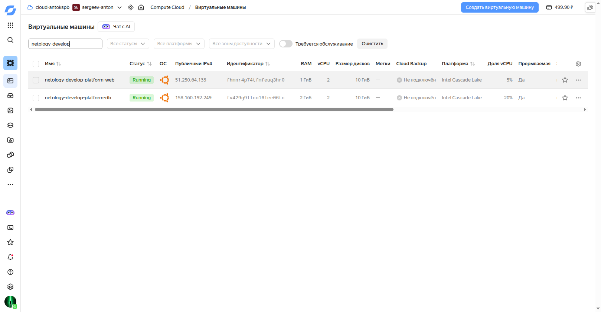
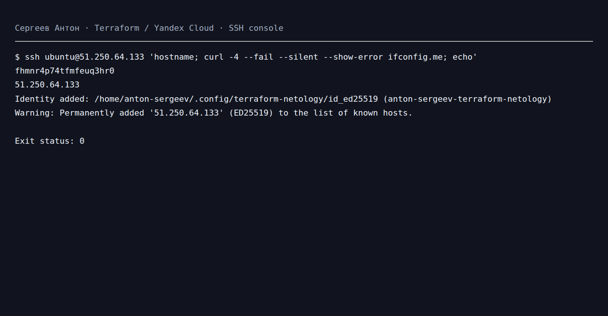

# Основы Terraform. Yandex Cloud

Выполнил: Сергеев Антон.

## Конфигурация

Terraform `~> 1.12.0`. Провайдер зафиксирован в `.terraform.lock.hcl`.

| ВМ | Зона | Платформа | vCPU | RAM | Доля CPU |
| --- | --- | --- | --- | --- | --- |
| netology-develop-platform-web | ru-central1-a | standard-v2 | 2 | 1 ГБ | 5% |
| netology-develop-platform-db | ru-central1-d | standard-v2 | 2 | 2 ГБ | 20% |

Обе ВМ прерываемые, с Ubuntu 20.04 LTS, дисками network-ssd 10 ГБ и внешними IP. Для каждой зоны предусмотрена отдельная подсеть. Из-за исчерпанной квоты сетей используется существующая сеть `network-1` через `existing_network_id`; при `null` создаётся новая сеть. SSH разрешён только с адресов `ssh_allowed_cidrs`; исходящий трафик разрешён. Группы безопасности отслеживают соединения, ответный трафик разрешается автоматически.

## Ответы

1. `standart-v4` — неверный идентификатор платформы. Для учебной конфигурации с 5% CPU выбрана `standard-v2`. Одно ядро заменено на два: это минимальное число vCPU для этой платформы. Это ошибки значений конфигурации, а не синтаксиса HCL.
2. `preemptible = true` снижает стоимость ВМ, но облако может остановить её; подходит для временных лабораторных работ.
3. `core_fraction = 5` гарантирует 5% процессорного времени каждого vCPU и экономит бюджет. Подходит для SSH и небольших учебных нагрузок; фактическая производительность может быть выше.
4. `service_account_key_file` получает путь к файлу вне Git. `file()` из исходника возвращал содержимое JSON, что также допускается провайдером; считать это синтаксической ошибкой нельзя.

## Файлы

- `variables.tf`: параметры облака, сети, общая `map(object)` metadata.
- `vms_platform.tf`: переменные обеих ВМ, `vms_resources` типа `map(object)`.
- `locals.tf`: имена ВМ через интерполяцию нескольких переменных и преобразование metadata в формат API.
- `outputs.tf`: один output `instances` с именем, внешним IP и FQDN каждой ВМ без хардкода.
- Неиспользуемые прежние переменные закомментированы.

## Запуск

```bash
export TF_CLI_CONFIG_FILE="$PWD/.terraformrc"
cp terraform.tfvars.example terraform.tfvars
# Указать свой публичный SSH-ключ и разрешённый IPv4 CIDR.
terraform init
terraform fmt -check
terraform validate
terraform plan -out=deployment.tfplan
terraform apply deployment.tfplan
terraform output
terraform plan -detailed-exitcode
```

Авторизованный ключ сервисного аккаунта: `~/.config/terraform-netology/authorized_key.json` (либо свой путь через переменную). Приватные ключи, tfvars, планы и state исключены из Git. State необходимо сохранить локально для дальнейшего управления ресурсами.

```bash
eval "$(ssh-agent -s)"
ssh-add ~/.config/terraform-netology/id_ed25519
ssh ubuntu@EXTERNAL_IP 'curl -4 --fail --silent --show-error ifconfig.me; echo'
```

Проверка отсутствия изменений: код возврата `terraform plan -detailed-exitcode` должен быть `0`; `2` означает изменения, `1` — ошибку. Итоговый нулевой план не доказывает отдельное прохождение промежуточных этапов 2 и 6.

## Отклонения

Из-за отказов API `Zone ru-central1-b is not available` и исчерпанной HDD-квоты используются зона `ru-central1-d` для DB и SSD 10 ГБ для обеих ВМ. Исходные значения задания сохранены в defaults; фактические переопределения приведены в `terraform.tfvars.example`.

## Сервисный аккаунт

`terraform-netology-02` создан в учебном каталоге. Назначены `compute.editor`, `vpc.privateAdmin`, `vpc.publicAdmin`, `vpc.securityGroups.admin`: управление вычислительными и сетевыми ресурсами без общей роли `editor`. Эти роли распространяются на весь каталог. Авторизованный ключ и SSH-пара созданы отдельно от Git.

## Проверки

`terraform init`, `terraform fmt -check` и `terraform validate` выполнены успешно на Terraform 1.12.0, Linux amd64. Первое применение остановилось на квоте сетей; конфигурация адаптирована для использования существующей сети без её изменения. Второе применение создало обе подсети и группу безопасности, но ВМ не созданы: `Quota limit network-hdd` в зоне a и `Zone ru-central1-b is not available`. После согласования изменены зона DB и тип дисков. Обе ВМ созданы, SSH проверен на обеих, `curl ifconfig.me` вернул соответствующие внешние IP. Итоговый `terraform plan -detailed-exitcode`: `No changes`, код `0`.

## Источники

- [Исходный проект](https://github.com/netology-code/ter-homeworks/tree/main/02/src)
- [Группы безопасности](https://yandex.cloud/ru/docs/vpc/concepts/security-groups)
- [Производительность vCPU](https://yandex.cloud/ru/docs/compute/concepts/performance-levels)
- [Прерываемые ВМ](https://yandex.cloud/ru/docs/compute/concepts/preemptible-vm)

## Результаты

```hcl
instances = {
  "db" = {
    "external_ip" = "158.160.192.249"
    "fqdn" = "fv429g9llco16lee06tc.auto.internal"
    "instance_name" = "netology-develop-platform-db"
  }
  "web" = {
    "external_ip" = "51.250.64.133"
    "fqdn" = "fhmnr4p74tfmfeuq3hr0.auto.internal"
    "instance_name" = "netology-develop-platform-web"
  }
}
```





SSH-скриншот получен в локальной веб-консоли: она выполнила настоящий SSH-сеанс и отобразила его stdout/stderr. Это не снимок системного терминала.

- [Terraform output](evidence/terraform-output.txt)
- [Итоговый план без изменений](evidence/terraform-plan.txt)
- [Протокол SSH Web](evidence/ssh-curl.txt)
- [Протокол SSH DB](evidence/ssh-db.txt)
